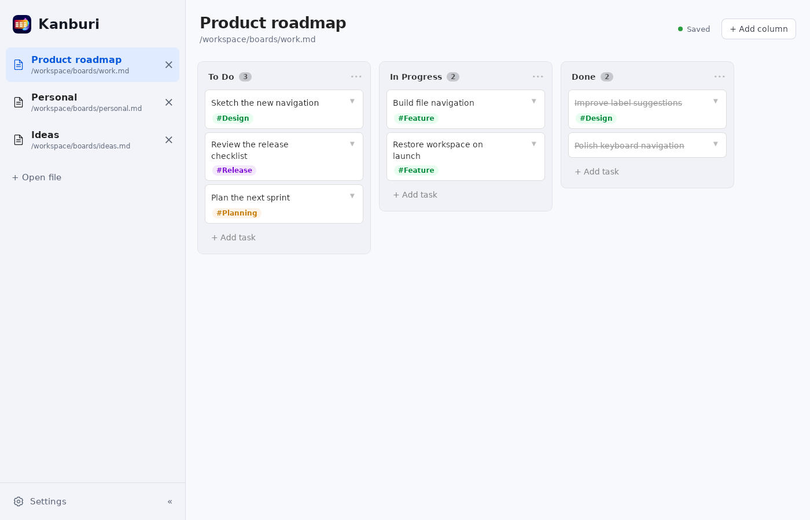

# Kanburi



A native desktop Kanban board that saves everything in a single, human-readable Markdown file — no database, no account, no sync service required.

---

## Features

- Open multiple Markdown files in vertical tabs and switch between boards
- Restore open files and the selected tab when the app starts
- Drag cards between columns
- Labels, due dates, and descriptions per card
- Search task titles, descriptions, and labels within each open board
- Label autocomplete from labels used on the current board
- All data persisted in a plain `.md` file you own

## Getting started

1. Launch **Kanburi**.
2. Click **Open file** and choose (or create) a `.md` file.
3. Your board loads from that file. Changes are saved automatically.
4. Use **+ Open file** in the sidebar to open more files (multiple selection is supported). Select a file to switch boards; **×** closes its tab without deleting the file. Arrow Up/Down, Home, and End navigate the file tabs.

Drag the sidebar’s right border to resize it. Near the minimum width it snaps to either the expanded minimum or the collapsed icon rail. Drag the collapsed border to the right to reopen it; double-click the border to reset and expand it. You can also focus the border and use Left/Right arrows, Home, or End. Collapsing and expanding the sidebar preserves its current width, and follows your system’s reduced-motion preference.

The first Markdown H1 is used as the document name in the sidebar and board header. Without an H1, the filename is shown. Titles are preserved when saving; files without an H1 remain untitled. Hover over a tab to see its full path.

**Settings → Restore open files on startup** is enabled by default. Kanburi remembers the open files, selected tab, and sidebar state. It reads the latest Markdown contents when restoring; missing or unreadable files are reported and skipped. Closing every tab saves an empty session. Disable restoration to start with an empty workspace.

Workspace preferences and file paths are stored in `settings.toml` in the operating system’s application configuration directory for `com.kanburi.app` (for example, `$XDG_CONFIG_HOME/com.kanburi.app/` or `~/.config/com.kanburi.app/` on Linux). Board contents remain exclusively in your Markdown files. If settings cannot be read, Kanburi reports the problem without overwriting them; choose **Retry** or explicitly reset with **Use default settings**.

> **Tip:** Keep your board file in a cloud-synced folder (iCloud Drive, Dropbox, etc.) to access it from multiple machines.

## Searching tasks

Click the search icon in the board header to reveal the search field. Combine
free text with `#Label` and `due:` tokens, for example:

```text
login #Backend due:today
```

Free-text words match titles, descriptions, or labels without case sensitivity.
Each word and each filter must match (AND). Tags match full, case-sensitive label
names; multiple tags require all of them. Empty input and whitespace after a term
show `#` and `due:` suggestions. Typing narrows these suggestions; choosing one
inserts the qualifier and immediately opens its value suggestions. Completing a
value adds a space and shows the next qualifier suggestions. Manually typing a
space after free text or a filter does the same. Typing `#` suggests existing labels in
the current board. Typing `due:` suggests `overdue`, `today`, `tomorrow`, `week`
(today through six days from now), `none`, and today's date. You can also type an
exact date, such as `due:2026-11-03`. Dates use your local calendar and include
completed tasks. Invalid deadlines mark the search field as invalid and match no tasks.

Use Up/Down to select a suggestion, Enter or Tab to insert it, or click it. Escape
first dismisses suggestions, then collapses the search field. The search icon also
toggles the field; collapsing keeps the query active and shows a blue indicator.
**Clear search** removes the query. Columns remain visible with matching counts.
Each board keeps its own query until closed. Queries are not saved to Markdown or
restored after restarting. Editing and dragging filtered cards still saves the
complete board, including hidden tasks.

## Markdown file format

```markdown
# Tasks

## To Do

- [ ] Add unit tests for auth module #backend #testing @2025-05-12
- [ ] Write API documentation #docs
- [ ] Investigate memory leak in worker pool #backend
  Observed in production since v1.4. Check thread cleanup on timeout.

## In Progress

- [ ] Refactor database connection pooling #backend #refactor
  Migrate from raw connections to a pooled client.
  Benchmark before and after with k6.
- [ ] Set up staging environment #devops @2025-05-10

## Done

- [x] Fix login redirect bug #frontend
- [x] Add CI pipeline #devops
  Runs lint, test, and build on every pull request.
- [x] Upgrade to Node 22 #maintenance
```

- Each `##` heading is a column.
- Each `- [ ]` / `- [x]` line is a task (`[x]` = done).
- `#Label` adds a label to the task (multiple allowed).
- `@YYYY-MM-DD` sets the due date.
- Lines indented with 2 spaces below a task are its description (multi-line supported). Indented checkboxes and blank lines stay in the description.
- Tasks before the first column heading are placed in a `To Do` column.
- Due dates are calendar dates in your local timezone.

## Contributing

See [CONTRIBUTING.md](./CONTRIBUTING.md) for development setup, build instructions, and architecture notes.

## Label editing

Expand a card and use **+** to add a label, or click a label name to change it
on that card only. Suggestions come from the open board; no separate label
history or storage is created. Labels no longer used by any card stop appearing
in suggestions. Matching ignores case, but label names remain case-sensitive.

Use the arrow keys to select a suggestion and Enter to save, or click a suggestion.
For a new name, choose **Add #name** or press Enter without selecting a suggestion.
Escape, clicking outside, or leaving the field cancels the unfinished edit.
Labels already on the card cannot be added again, and names cannot contain
whitespace because Markdown stores labels as individual `#name` tokens.
